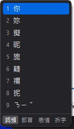
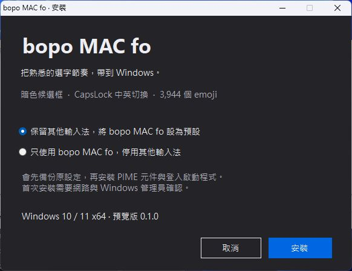

# bopo MAC fo

**把熟悉的選字節奏，帶到 Windows。**

以 [小麥注音／McBopomofoWeb](https://github.com/openvanilla/McBopomofoWeb) 與 [PIME](https://github.com/EasyIME/PIME) 為基礎，調整成更接近 Mac 習慣的 Windows 注音輸入體驗：精簡暗色候選框、CapsLock 中英切換，以及可以放在旁邊點選的 emoji 圖庫。

**[下載 0.1.0 預覽版](https://github.com/lancer1234/bopo-mac-fo/releases/tag/v0.1.0-preview.1)** · [簡易教學](docs/QUICKSTART.md) · [致謝與授權](THIRD_PARTY_NOTICES.md) · [回報問題](https://github.com/lancer1234/bopo-mac-fo/issues)

&nbsp;&nbsp;

## 有什麼不同？

- **字後選字**：游標在字的後方按 ↓ 選字。
- **CapsLock 切中英**：短按切換中英文；按住約 500 毫秒，當下啟用／關閉大寫鎖定。
- **小巧的暗色候選框**：詞頻、部首、表情與拆字四個分頁。部首與拆字提供目前候選字的資訊。
- **注音也能留下來**：未轉成中文前，Enter 可確認注音；選字末尾也有含聲調的注音選項。
- **浮動 emoji 面板**：Ctrl + Alt + E 開關；3,944 項（含膚色與組合），可分類、用中英文搜尋、連續點選插入。
- **保留打字節奏**：插入 emoji 或切換中英時保留未確認文字；Shift＋符號鍵輸入鍵盤上方符號。

## 簡單安裝

1. 到 [Releases](https://github.com/lancer1234/bopo-mac-fo/releases) 下載 **`bopo-mac-fo-0.1.0-windows-x64.zip`**。
2. **完整解壓縮**，執行 `Setup.exe`，選擇保留其他輸入法或只使用 bopo MAC fo。
3. 按「安裝」，由你確認 Windows 管理員提示；完成後重新開啟要輸入文字的應用程式。

不必自行編譯、安裝 Node.js，或手動註冊 DLL。缺少 PIME 時，安裝器會下載官方的 PIME 1.3.0 安裝程式並核對 SHA-256。首次安裝需要網路。

## 常用操作

| 操作 | 按鍵 |
|---|---|
| 中英文切換 | 短按 CapsLock |
| 大寫鎖定 | 按住 CapsLock 約 500 毫秒；達門檻時立即切換 |
| 選字 | 在字後按 ↓；用數字或方向鍵選擇 |
| 直接確認未完成的注音 | Enter |
| 中文換回注音 | 在候選末尾選擇帶聲調的注音 |
| 表情浮動視窗 | Ctrl + Alt + E；點右上 × 隱藏 |
| 表情換頁 | 滾輪或面板底部箭頭 |
| 鍵盤上方符號 | Shift＋符號鍵 |
| 加入使用者詞彙 | Shift＋左右方向鍵框選，Enter 加詞 |

## 試用前知道的幾件事

- 目前是 **Windows 10／11 x64 預覽版**，支援 x64 與 x86 應用程式；尚未支援 Windows ARM64。需使用可確認管理員提示的同一個 Windows 帳號。
- 這是 McBopomofo／PIME 的客製整合，**沿用 PIME 小麥的輸入法識別**，會更新 PIME 共用服務與小麥設定。不是另一套獨立的注音核心；請勿與另一個 PIME 小麥客製版同時安裝。
- 保留其他輸入法是預設選項。只有自行選擇「只使用 bopo MAC fo」時，才整理語言清單並停用微軟注音、新酷音。
- 圖庫使用 Microsoft Fluent Emoji，2,840 項有對應彩色圖片，其餘使用系統字型。插入的是標準 Unicode，**顏色與造型由目標程式／裝置決定**；不包含 Apple emoji 圖片或字型。
- 核心輸入已在開發機實測；尚未完成全新 Windows、多使用者與所有應用程式的相容性測試。安裝包未做商業程式碼簽署；遇到 Windows 阻擋時，先核對來源與雜湊，請勿關閉系統防護。

## 解除安裝與資料

在 Windows「已安裝的應用程式」找到 **bopo MAC fo** 解除安裝，會停止輔助程式並還原備份設定、原本的 PIME 服務與輸入法清單。詞庫、備份與 PIME 前置元件會保留；已載入的程式檔需重新登入後才會卸載，剩餘檔案可參考[回復教學](docs/QUICKSTART.md#解除安裝與回復)。預覽版更新請先解除安裝舊版。

輸入內容與個人詞庫只在本機處理，不含遙測。公開程式庫及安裝包**不包含開發者的個人詞庫、輸入紀錄或帳號資訊**。

## 開源、致謝與開發

謝謝 McBopomofo、McBopomofoWeb、PIME、libIME2、NIME、CJKVI／CHISE、Unicode／CLDR、Microsoft Fluent Emoji，以及所有基礎套件的作者。原始碼和授權保留於 `upstream/`、`LICENSES/`；詳細來源、版本與修改範圍見 [THIRD_PARTY_NOTICES.md](THIRD_PARTY_NOTICES.md)。

新增整合程式碼採 [GPL-2.0](LICENSE)，上游檔案保留原授權；含 GPL 拆字資料的發行內容不可僅視為 MIT。這是社群專案，非 Apple、Microsoft 或上游團隊的官方產品。

想自己編譯或改介面，請看 [BUILDING.md](docs/BUILDING.md)。
